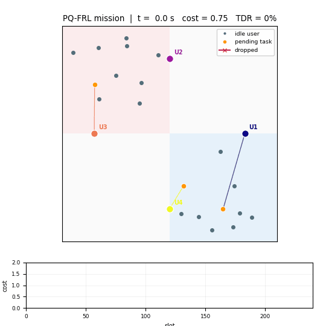

<div align="center">

# PQ-FRL · demo

### Privacy-preserving and quality-aware federated reinforcement learning for UAV-assisted edge computing

**A compact, CPU-runnable implementation of the method — built to be read, run and modified in minutes.**

[](https://www.python.org/)
[](https://pytorch.org/)
[](LICENSE)
[](https://doi.org/10.1109/JIOT.2026.3695149)

[Project page](docs/index.html) · [Portfolio copy](docs/PORTFOLIO.md) · [中文说明](README.zh-CN.md)

</div>

> **What this repository is.** A reduced-scale re-implementation of the method in *"PQ-FRL: A
> Privacy-Preserving and Quality-Aware Federated Reinforcement Learning for UAV-Assisted Edge
> Computing"* (IEEE IoT-J 2026). It is written from the paper's method section rather than derived
> from its simulation code, so that the mechanism can be inspected and run on a laptop.
>
> **What it is not.** It is not a reproduction of the paper's experiments. The network, the number
> of rounds, the number of seeds and — deliberately — the DP noise calibration differ (see
> [Demo vs. paper](#demo-vs-paper)). **Numbers produced here are not comparable with the paper's
> figures.**

---

## Demo at a glance



Four UAVs learn trajectories and offloading decisions with DDPG, upload differentially-private
actor updates and average rewards, and a ground station aggregates them with a quality-aware
softmax. The animation (generated by `make_animation.py`) shows the trained policy: lines are
offloaded tasks, red crosses are deadline violations.

---

## What this demo shows — and what it does not

**Shows**

- the full mechanism of the paper end to end: system model → DDPG with a mixed action space and a
  straight-through estimator → output-perturbation DP on the upload → softmax aggregation on the
  DP-protected reward;
- that with an identical privacy budget, reward-weighted aggregation converges to a lower cost than
  uniform aggregation (DP-FedAvg) in this environment;
- that the aggregation weights move away from uniform and track the clients that report high
  protected rewards;
- that the cost advantage appears mostly through the task-drop rate, matching the paper's
  qualitative component story;
- engineering hygiene: six algorithms behind one config, cached runs, deterministic evaluation,
  unit checks and CI.

**Does not show**

- the paper's absolute numbers or effect sizes (the demo's spread is ~8% where the paper's is ~2×);
- that the paper's claims hold at full scale — that requires the full simulation;
- the swarm-size trend: the simplified channel has no inter-UAV interference, so adding UAVs here
  *reduces* per-UAV load instead of congesting the airspace;
- a certified end-to-end privacy guarantee (see [Privacy calibration](#privacy-calibration)).

---

## Quick start

```bash
git clone https://github.com/vectordai2000/pq-frl-demo.git
cd pq-frl-demo
python -m venv .venv && source .venv/bin/activate    # Windows: .venv\Scripts\activate
pip install -r requirements.txt

python train.py --algo pq-frl                 # one run, ~1 min on a laptop CPU
python experiments.py --figures convergence   # rebuild a figure (cached runs)
python make_animation.py                      # render the rollout GIF (~1 min)
python tests/test_all.py                      # 8 sanity checks
```

Everything is NumPy + PyTorch; CPU is faster than GPU for this model. `experiments.py` caches every
training run under `results/runs/`, so figures can be rebuilt without retraining.

---

## The six algorithms

| Algorithm | DP | Aggregation |
|---|:--:|---|
| **PQ-FRL** | yes | softmax over the protected local reward |
| Q-FRL (non-private ablation) | no | softmax over the local reward |
| DP-FedAvg | yes | uniform average |
| DP-FedRep | yes | reputation-weighted average (EMA of update consistency) |
| Standard FedAvg | no | uniform average |
| Local-Only | no | — (no federation) |

---

## Illustrative results

Demo preset, hotspot layout, two seeds. All numbers below are produced by this repository and are
meant to be read as *relative* ordering, not as measurements.

### Convergence


| Algorithm | Converged cost |
|---|---|
| **PQ-FRL** | **0.968 ± 0.039** |
| DP-FedAvg | 1.051 ± 0.027 |
| Q-FRL (non-private) | 1.060 ± 0.049 |
| DP-FedRep | 1.073 ± 0.008 |
| Standard FedAvg | 1.091 ± 0.179 |
| Local-Only | 1.158 ± 0.026 |

With two seeds and this small network, the non-private ablation lands inside the seed spread, so the
demo cannot resolve the privacy–utility gap; what it does show is the ordering between the DP
methods and the local-only baseline. Treat it as a mechanism demonstration, not as evidence for the
paper's effect sizes.

### What the aggregation does


The softmax weights drift away from `1/N = 0.25` and follow the clients whose protected reward is
high. This is the "Q" of PQ-FRL: the only extra information leaving a UAV is one scalar per round.

### What the policy learns


A 40-second deterministic rollout of the trained swarm. The agents slow down (≈10 m/s, near the
energy optimum of the rotary-wing model) and hold position at the edge of a hotspot instead of
sweeping the whole area — the behaviour behind the drop-rate reduction below.

### Component breakdown


| Algorithm | Avg. cost | Avg. latency [s] | Avg. energy [J] | TDR [%] |
|---|---|---|---|---|
| **PQ-FRL** | **1.01** | 0.114 | 22.4 | **13.9** |
| DP-FedAvg | 1.08 | 0.108 | 22.1 | 18.1 |
| DP-FedRep | 1.08 | 0.109 | 23.0 | 16.8 |
| Q-FRL | 1.11 | 0.113 | 22.9 | 18.2 |
| Local-Only | 1.18 | 0.108 | 22.8 | 22.3 |
| Standard FedAvg | 1.27 | 0.101 | 22.6 | 27.1 |

At this operating point the energy term is nearly constant across algorithms, so the difference is
essentially the task-drop rate — which is exactly the term PQ-FRL reduces.

### Privacy budget and weighting temperature

<p align="center">
  
  
</p>

Two-seed privacy sweep, single-seed η sweep. At ε ∈ {0.5, 1, 2} PQ-FRL stays flat at 0.97–0.98
while DP-FedAvg degrades from 1.00 (ε = 4) to 1.27 (ε = 0.5) as the noise grows; at ε = 4 (weak
noise) PQ-FRL's point rises to 1.12 and the ranking is no longer resolved by this demo. The η sweep
has its minimum at the paper's η = 0.5. Both curves carry seed-level noise — see
[Known limitations](#known-limitations).

`python experiments.py --figures none` rebuilds the tables in `results/summary.md` from cached runs.

---

## How it works

```
              ┌──────────────────────── FRL round t ────────────────────────┐
   GBS        │  broadcast Θ_G(t-1)                                          │
              │      │                                                       │
              │      ▼                                                       │
   UAV n      │  local DDPG for T_G slots  ──►  Δθ_n = θ_n - Θ_G(t-1)        │
              │                                   │                          │
              │                                   ▼                          │
   privacy    │            Δθ̃_n = clip(Δθ_n, C) + N(0, σ²I)                  │
              │            R̃_n   = clip(R̄_n, C_R) + N(0, σ_R²)              │
              │                                   │                          │
              │                                   ▼                          │
   GBS        │        w_n = softmax(η · R̃_n)   (Eq. 14)                     │
              │        ΔΘ_G = Σ_n w_n Δθ̃_n      (Eq. 15)                    │
              │        Θ_G(t) = Θ_G(t-1) + ΔΘ_G                              │
              └──────────────────────────────────────────────────────────────┘
```

### 1. Environment (`pqfrl/env.py`)

A discrete-time UAV-MEC system: `N` UAVs at fixed altitude, `K` ground users, one ground station.
Each slot a GU may generate a task `(D_k, c_k)`; it is offloaded over an OFDMA uplink or computed
locally, subject to a deadline. The immediate cost is

```
C(t) = w_T · mean latency + w_E · mean energy + w_P · 10 · TDR.
```

NumPy only — the model can be read without a simulator dependency.

### 2. Local DDPG with a mixed action space (`pqfrl/agents.py`)

Each actor emits `[v, θ, β̃_1..β̃_L, f̃_1..f̃_L]`: speed, heading, one offloading probability and one
CPU-demand share per candidate GU. The environment thresholds `β̃`; the critic receives the
continuous value, so the gradient flows through the relaxed variable — a straight-through estimator.
Only the actor is federated; each UAV keeps its own critic.

### 3. Output-perturbation DP (`pqfrl/dp.py`)

Privacy is applied once per round, at the upload boundary:

```
Δθ̃_n = clip(Δθ_n, C) + N(0, σ²I),        σ = √(2 ln(1.25/δ)) · C / (ε · √P)
R̃_n  = clip(R̄_n, C_R) + N(0, σ_R²)
```

The reward is released because it is the aggregation signal; protecting it with the same mechanism
is what keeps the "Q" from becoming a side channel.

### 4. Quality-aware aggregation (`pqfrl/aggregators.py`)

```
w_n = softmax(η · clip(R̃_n))        # Eq. 14, clipped for numerical robustness
Θ_G ← Θ_G + Σ_n w_n · Δθ̃_n          # Eq. 15
```

---

## Privacy calibration

At ε = 1, an output perturbation of a full actor requires σ ≈ 4.9·C, i.e. noise whose norm is about
five times the clipped update norm. For a compact demo network that erases the learning signal, so
two knobs are explicit and configurable:

1. **Adaptive clipping** — `C` is re-estimated every `--clip-refresh` rounds from the observed
   update norms (`--clip-norm 5.0` restores a fixed bound).
2. **Noise scale** — `--dp-noise-scale` multiplies the textbook noise (default `0.05`, `1.0` is the
   textbook calibration). The value is stored with every result, and the effective noise-to-update
   ratio is in `history.noise_norm / history.delta_norm`.

The demo therefore illustrates the mechanism and its utility cost, not a certified end-to-end
guarantee. For the strict regime:

```bash
python train.py --preset paper --dp-noise-scale 1.0 --clip-norm 5.0 --eps 1.0
```

and account the total budget with `pqfrl.dp.compose_eps` (advanced composition).

---

## Demo vs. paper

`--preset demo` is the default; `--preset paper` restores the Table I parameter values.

| Parameter | Paper (Table I) | Demo | Why |
|---|---|---|---|
| Deadline `Tmax` | 5.0 s | 0.5 s | makes the deadline bind, so dropping (and hence the policy) matters |
| Task arrival | 0.5 /s per GU | 2.0 /s per GU | enough load to separate clients within 200 rounds |
| Hidden units | (256, 128) | 64 | CPU-sized |
| Learning rate | 1e-4 | 1e-3 | for 200 instead of 5000 rounds |
| Rounds | 5000 | 200 | runtime |
| Candidate GUs | dynamic `K_n(t)` | 5 nearest | fixed-size action space |
| Energy in cost | J | J / 10 | keeps the three cost terms commensurate |
| Clipping bound | 5.0 (fixed) | adaptive | see [Privacy calibration](#privacy-calibration) |
| Noise calibration | textbook (ε = 1) | `dp-noise-scale = 0.05` | see [Privacy calibration](#privacy-calibration) |
| Reward | Eq. (11) | Eq. (11) + local-cell latency attribution | aligns the local reward with `C(t)` so that "accept/reject everything" is not a local optimum |

The DP equations, aggregation formula and baseline definitions follow the paper. The channel omits
inter-UAV interference (see above); the energy model and remaining components follow the paper's
equations.

---

## Known limitations

* **Not a reproduction.** Reduced scale, different DP calibration, no inter-UAV interference. See
  [What this demo shows](#what-this-demo-shows--and-what-it-does-not).
* **Small statistics.** Two seeds for the convergence figure and the privacy sweep, one seed for the
  temperature sweep. Use `--seeds 5 --rounds 500` before reading anything into a difference.
* **Data-dependent clipping.** The adaptive bound is estimated from the observed updates, so the
  formal sensitivity argument of the paper does not directly apply to the demo's default mode.
* **Swarm-size behaviour is not reproduced**: with no inter-UAV interference, more UAVs mean more
  capacity per task. `python experiments.py --figures scalability` will show a decreasing curve.

---

## Repository layout

```
pq-frl-demo/
├── train.py                 # one training run, CLI
├── experiments.py           # figures + tables, with a run cache
├── make_animation.py        # rollout GIF
├── tests/test_all.py        # fast sanity checks (also run by CI)
├── pqfrl/
│   ├── config.py            # dataclass config, presets, algorithm switches
│   ├── env.py               # UAV-MEC environment (paper Sec. III)
│   ├── agents.py            # DDPG, replay buffer, STE
│   ├── dp.py                # clipping, Gaussian mechanism, accounting
│   ├── aggregators.py       # FedAvg / QA-softmax / reputation
│   ├── server.py            # Algorithm 1 + evaluation
│   └── plotting.py          # figures
├── results/
│   ├── figures/             # generated figures and the rollout GIF
│   └── summary.md           # generated tables
├── docs/
│   ├── index.html           # GitHub Pages project page
│   └── PORTFOLIO.md         # ready-to-paste portfolio copy (EN / 中文)
├── requirements.txt
├── CITATION.cff
└── LICENSE
```

---

## Command-line reference

| Flag | Meaning |
|---|---|
| `--algo` | `pq-frl`, `q-frl`, `dp-fedavg`, `dp-fedrep`, `fedavg`, `local-only` |
| `--preset` | `demo` (default) or `paper` |
| `--scenario` | `iid` or `hotspot` |
| `--rounds`, `--tg` | aggregation rounds / slots per round |
| `--eps`, `--dp-noise-scale` | privacy budget and noise calibration |
| `--eta` | softmax temperature of the quality-aware aggregation |
| `--n-uav` | swarm size `N` |
| `--device` | `cpu` (default, faster here) or `cuda` |
| `--out` | output directory |

`python train.py --help` and `python experiments.py --help` list everything.

---

## Extending the demo

* **Another aggregation rule** — add a function to `pqfrl/aggregators.py`, register it in
  `compute_weights`, then add an entry to `ALGO_DEFAULTS` in `pqfrl/config.py`.
* **Another environment** — `UAVMECEnv` exposes `reset` / `step`; `pqfrl/server.py` uses only
  `state_dim`, `action_dim`, `reset` and `step`.
* **A stronger privacy analysis** — replace `compose_eps` with an RDP accountant; the per-round
  mechanism is the standard Gaussian mechanism, so any accountant applies.

---

## Citation

```bibtex
@article{dai2026pqfrl,
  title   = {PQ-FRL: A Privacy-Preserving and Quality-Aware Federated Reinforcement Learning
             for UAV-Assisted Edge Computing},
  author  = {Dai, Zifeng and Xie, Hui and Wei, Shengjun and Hu, Changzhen},
  journal = {IEEE Internet of Things Journal},
  year    = {2026},
  doi     = {10.1109/JIOT.2026.3695149}
}
```

## License

MIT — see [LICENSE](LICENSE). If you reuse the figures or the text, a link back to this repository
and to the paper is appreciated.
