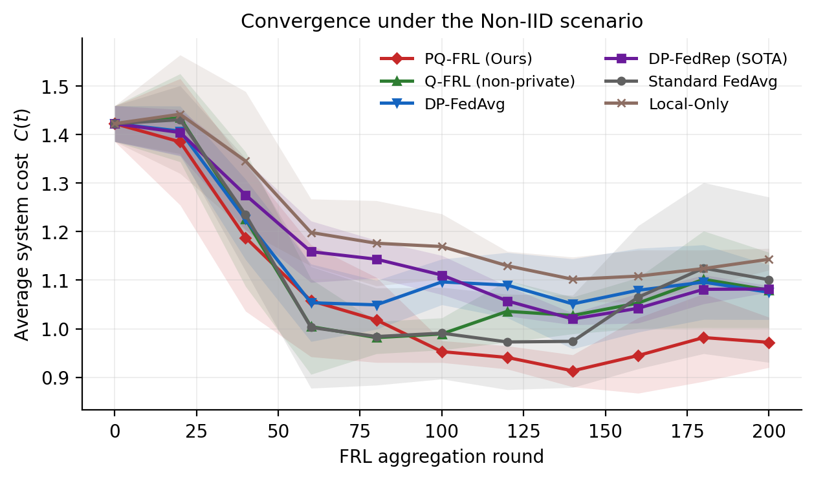
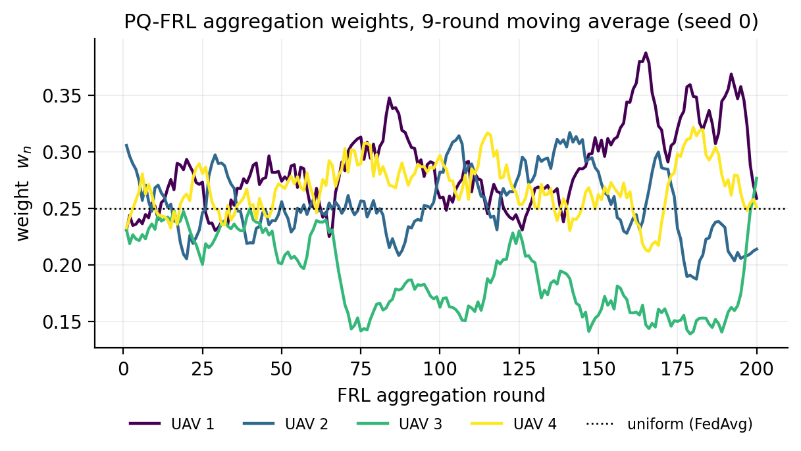
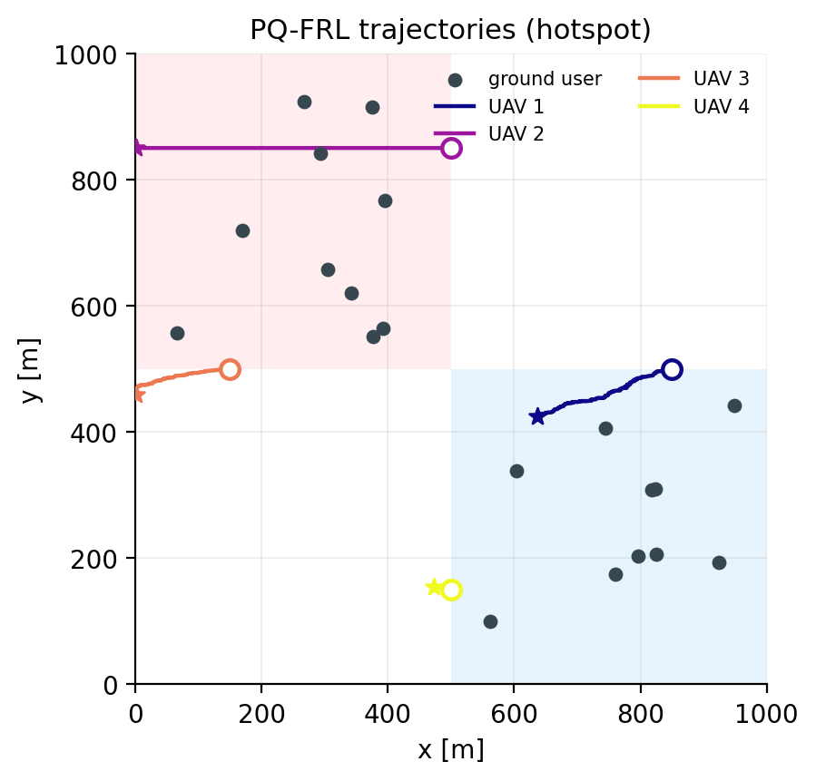
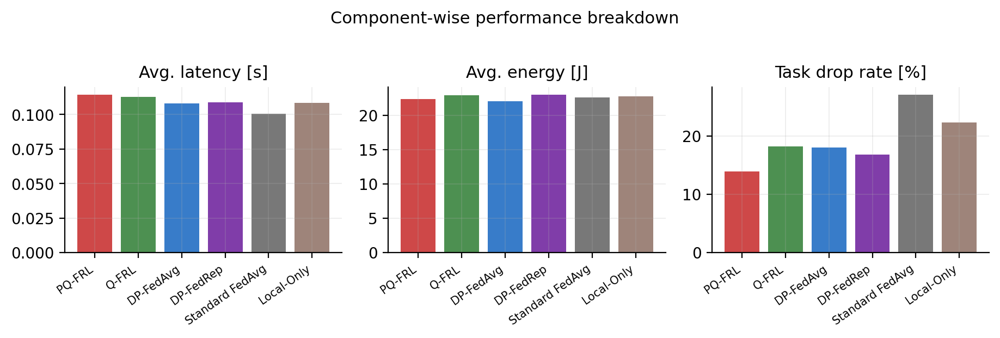
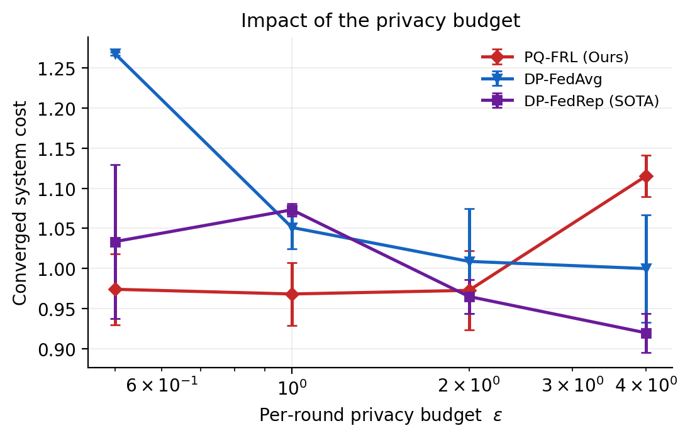
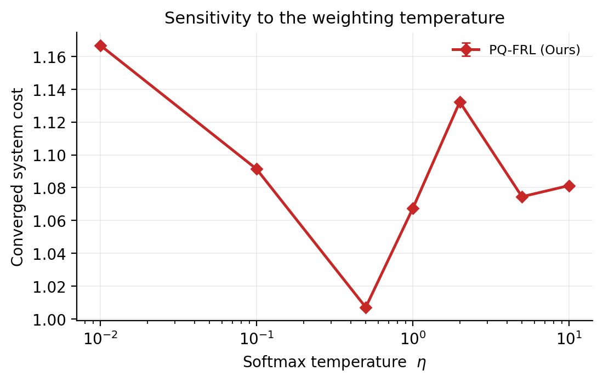

# PQ-FRL 演示代码（中文说明）

> 论文：*PQ-FRL: A Privacy-Preserving and Quality-Aware Federated Reinforcement Learning for
> UAV-Assisted Edge Computing*，IEEE Internet of Things Journal, 2026.
> DOI: [10.1109/JIOT.2026.3695149](https://doi.org/10.1109/JIOT.2026.3695149)
>
> 项目主页：[docs/index.html](docs/index.html) · 英文 README：[README.md](README.md) ·
> 主页文案：[docs/PORTFOLIO.md](docs/PORTFOLIO.md)

本仓库是论文方法的**精简重写版**，用于展示机制与工程实现：UAV-MEC 系统模型、DDPG 本地训练与
混合动作空间（STE）、上传更新上的输出扰动差分隐私（DP），以及基于 DP 保护后本地奖励的
**质量感知（QA）Softmax 聚合**。笔记本 CPU 上约 1 分钟即可跑完一次训练。

**重要说明**：本仓库依据论文方法一节重写，而非由论文的仿真代码派生。它不是论文实验的复现，
网络规模、轮数、种子数以及 DP 噪声标定都与论文不同（见[与论文的差异](#与论文的差异)），
**其中数值不可与论文图表直接比较**。

## 它展示什么 / 不展示什么

**展示**

- 论文机制的端到端完整链路：环境 → DDPG + 直通估计器 → 上传前输出扰动 DP → 基于受保护奖励的 softmax 聚合；
- 在相同隐私预算下，奖励加权聚合在本环境中的收敛代价低于等权聚合（DP-FedAvg）；
- 聚合权重确实会偏离均匀值，并向受保护奖励高的客户端集中；
- 代价优势主要体现在任务丢弃率上，与论文的分量结论方向一致。

**不展示**

- 论文的绝对数值与效应量（demo 中方法间差距约 8%，论文中约 2 倍）；
- 论文结论在全量规模下成立——那需要完整的仿真实验；
- 集群规模趋势：简化信道没有无人机间干扰，本 demo 中增加无人机会**降低**单机负载；
- 可认证的端到端隐私保证（见[隐私标定](#隐私标定)）。

## 快速开始

```bash
pip install -r requirements.txt

python train.py --algo pq-frl                 # 单次训练，CPU 约 1 分钟
python experiments.py --figures convergence   # 重建图表（复用缓存）
python make_animation.py                      # 生成飞行动画 GIF
python tests/test_all.py                      # 8 项自检
```

`train.py` 会在 `results/` 下生成 `config.json`、`result.json` 与 `trajectory.png`；
`experiments.py` 的训练结果缓存在 `results/runs/`，不会重复训练。

## 支持的方法

| 方法 | 差分隐私 | 聚合方式 |
|---|:--:|---|
| **PQ-FRL（本文）** | 是 | 基于 DP 保护奖励的 Softmax 加权 |
| Q-FRL（非隐私消融） | 否 | 基于奖励的 Softmax 加权 |
| DP-FedAvg | 是 | 等权平均 |
| DP-FedRep | 是 | 基于更新一致性（信誉）的加权 |
| Standard FedAvg | 否 | 等权平均 |
| Local-Only | 否 | 不进行联邦 |

## 示意性结果

demo 预设、热点布局、2 个随机种子。以下数值均由本仓库生成，只应作为**相对排序**来读，而非测量值。

### 收敛曲线



| 方法 | 收敛代价 |
|---|---|
| **PQ-FRL** | **0.968 ± 0.039** |
| DP-FedAvg | 1.051 ± 0.027 |
| Q-FRL（非隐私） | 1.060 ± 0.049 |
| DP-FedRep | 1.073 ± 0.008 |
| Standard FedAvg | 1.091 ± 0.179 |
| Local-Only | 1.158 ± 0.026 |

2 个种子、小网络的条件下，非隐私消融落在种子波动范围内，因此本 demo 无法分辨隐私–效用差距；
它能展示的是各 DP 方法之间、以及它们与 Local-Only 之间的排序。请把它当作机制演示，而不是论文效应量的证据。

### 聚合权重



权重偏离 `1/N = 0.25`，向受保护奖励高的客户端集中。这就是 PQ-FRL 中“Q”的部分：
每轮每个客户端只多上传一个标量。

### 学到的策略



训练后策略的 40 秒确定性 rollout：无人机会降速到约 10 m/s（接近旋翼能耗模型的最优点），
并停留在热点边缘而不是遍历整个区域——这正是下面丢弃率下降的原因。

### 分量拆解



| 方法 | 平均代价 | 平均时延 [s] | 平均能耗 [J] | 任务丢弃率 [%] |
|---|---|---|---|---|
| **PQ-FRL** | **1.01** | 0.114 | 22.4 | **13.9** |
| DP-FedAvg | 1.08 | 0.108 | 22.1 | 18.1 |
| DP-FedRep | 1.08 | 0.109 | 23.0 | 16.8 |
| Q-FRL | 1.11 | 0.113 | 22.9 | 18.2 |
| Local-Only | 1.18 | 0.108 | 22.8 | 22.3 |
| Standard FedAvg | 1.27 | 0.101 | 22.6 | 27.1 |

在该工作点上，能耗项在各方法间几乎不变，因此差异主要体现在任务丢弃率——而这正是 PQ-FRL 降低的项。

### 隐私预算与加权温度

<p align="center">
  
  
</p>

隐私扫描为 2 个种子，η 扫描为 1 个种子。在 ε ∈ {0.5, 1, 2} 时 PQ-FRL 稳定在 0.97–0.98，
而 DP-FedAvg 随噪声增大从 1.00（ε = 4）退化到 1.27（ε = 0.5）；在 ε = 4（噪声很弱）处
PQ-FRL 的点升到 1.12，该区间的排序在本 demo 中无法分辨。η 扫描的最小值出现在论文取的 0.5 处。
两条曲线都含种子级噪声，见[已知限制](#已知限制)。

`python experiments.py --figures none` 可从缓存重建 `results/summary.md` 中的表格。

## 代码结构

```
pqfrl/
├── config.py        # 参数配置、demo/paper 预设、算法开关
├── env.py           # UAV-MEC 环境（论文第 III 节：信道、时延、能耗、代价、奖励）
├── agents.py        # DDPG Actor/Critic、经验池、STE
├── dp.py            # 裁剪 + 高斯机制、隐私预算合成（高级组合）
├── aggregators.py   # FedAvg / QA-Softmax / 信誉加权
├── server.py        # 算法 1：联邦训练主循环与评估
└── plotting.py      # 论文风格绘图

make_animation.py    # 飞行动画 GIF
experiments.py       # 图表与表格（带缓存）
tests/test_all.py    # 快速自检
docs/index.html      # GitHub Pages 项目主页（中英切换）
docs/PORTFOLIO.md    # 可直接粘贴到个人主页的文案（中英）
```

## 隐私标定

在 ε = 1 时，对整个 actor 做输出扰动需要 σ ≈ 4.9·C，即噪声范数约为裁剪后更新范数的 5 倍；
对小网络而言这会淹没学习信号。因此 demo 显式暴露两个可调项：

1. **自适应裁剪**：每 `--clip-refresh` 轮根据观测到的更新范数重新估计 `C`（`--clip-norm 5.0` 可恢复固定阈值）；
2. **噪声缩放**：`--dp-noise-scale` 乘在教材式噪声上（默认 `0.05`，`1.0` 为教材式标定）。
   每次运行都会把它与真实的噪声/更新比记录在 `history.noise_norm / history.delta_norm` 中。

因此 demo 展示的是机制及其效用代价，而非可认证的端到端隐私保证。严格模式：

```bash
python train.py --preset paper --dp-noise-scale 1.0 --clip-norm 5.0 --eps 1.0
```

并用 `pqfrl.dp.compose_eps` 对多轮预算做高级组合核算。

## 与论文的差异

`--preset demo` 为默认；`--preset paper` 可恢复论文 Table I 的参数。

| 参数 | 论文（Table I） | demo | 原因 |
|---|---|---|---|
| 任务截止时间 `Tmax` | 5.0 s | 0.5 s | 使截止时间真正起作用，让丢弃（从而策略）有意义 |
| 任务到达率 | 0.5 /s | 2.0 /s | 200 轮内即可拉开客户端差异 |
| 隐藏层 | (256, 128) | 64 | 降低算力需求 |
| 学习率 | 1e-4 | 1e-3 | 配合 200 轮而非 5000 轮 |
| 轮数 | 5000 | 200 | 运行时间 |
| 候选用户 | 动态集合 `K_n(t)` | 最近 5 个 | 固定动作维度 |
| 代价中的能耗 | J | J / 10 | 使三项代价量级可比 |
| 裁剪阈值 | 固定 5.0 | 自适应 | 见[隐私标定](#隐私标定) |
| 噪声标定 | 教材式（ε = 1） | `dp-noise-scale = 0.05` | 见[隐私标定](#隐私标定) |
| 奖励 | 式 (11) | 式 (11) + 本地覆盖区时延归属 | 使本地奖励与 `C(t)` 对齐，避免“全接受/全拒绝”成为局部最优 |

其余部分（信道、能耗模型、DP 公式、聚合公式、基线）均按论文。

## 已知限制

- **不是复现**：规模更小、DP 标定不同、没有无人机间干扰；
- **统计力度有限**：收敛图与隐私扫描 2 个种子，η 扫描 1 个种子。若要读差异，请用 `--seeds 5 --rounds 500`；
- **数据相关裁剪**：自适应阈值由观测到的更新估计，因此论文的正式敏感度论证不直接适用于 demo 默认模式；
- **集群规模趋势未复现**：无无人机间干扰时，增加无人机等于增加算力，`experiments.py --figures scalability` 会得到下降曲线。

## 引用

```bibtex
@article{dai2026pqfrl,
  title   = {PQ-FRL: A Privacy-Preserving and Quality-Aware Federated Reinforcement Learning
             for UAV-Assisted Edge Computing},
  author  = {Dai, Zifeng and Xie, Hui and Wei, Shengjun and Hu, Changzhen},
  journal = {IEEE Internet of Things Journal},
  year    = {2026},
  doi     = {10.1109/JIOT.2026.3695149}
}
```

## 许可

MIT License，详见 [LICENSE](LICENSE)。
